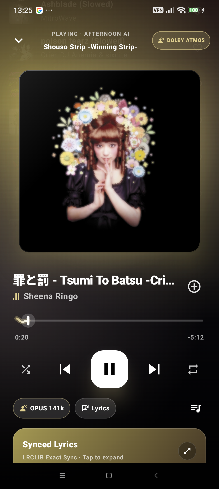

# Spotify Sovereign v5.0

100% independent Android music streaming client built in Kotlin + Jetpack Compose + AndroidX Media3, paired natively with **Mono TV** for ultra-lightweight cinema casting.

<p align="center">
  
</p>

## What's New in v5.0
- **Sovereign Cast to TV (`SovereignCastSender`)**: One-tap casting from Home or Now Playing to any Android TV running **Mono TV v5.0** — auto-discovery over UDP `:9472` + direct IP connect, bounded 512 KB chunk local HTTP audio relay (`:9471`), live TV remote mode, TV volume `−`/`+`, and real-time synced lyrics + offset streaming.
- **Zero-Duplicate Music Feed**: Strictly deduplicated Home **Music** tab across Spotlight, Quick Play, Jump Back In, From Your Likes, Vibe Picks, and Deep Cuts with fresh feed hydration.
- **Multi-Variant & Similar Songs Search**: Parallel search queries automatically surface every version of a track (*slowed*, *ultra slowed*, *sped up*, *reverb*, *original*) under **Songs & Versions**, alongside up to 14 matching vibe tracks under **Similar Songs & Vibes**.

## Core Architecture
- **Bounded-Chunk HTTP/2 Streaming Engine (`BoundedChunkOkHttpDataSource`)**: Seamless 512 KB range-chunk streaming + 512 MB LRU `SimpleCache` + predictive next-track pre-buffering (zero 0:00 stalls, zero 30s cutoffs).
- **32-bit Sovereign Studio Mastering & Dolby Atmos DSP (`SovereignDspEngine`)**: Hardware `DynamicsProcessing` 10-Band EQ (`31 Hz → 16 kHz`) + 5-Band Multiband Compressor + Brickwall Soft-Knee Limiter + Dolby Atmos 3D Spatializer + Sub-Bass Punch + Micro-Clarity Exciter across 8 live sound profiles + Custom 10-Band Graphic EQ.
- **Next-Gen Player UI**: Living 4-orb Ambient Aurora Mesh backdrop, swipe-to-skip interactive artwork stage (*Hero Squircle*, *Spinning Vinyl Disc*, *Cinematic Full*), animated Squiggly Wave progress scrubber with haptic feedback, morphing Play/Pause controls, and particle burst likes.
- **Cinema Synced Lyrics**: Optical depth-of-field blur (Android 12+), progressive luminous karaoke sweep, interlude breather dots, tap-to-seek, and per-track live sync offset tuner persisted in SQLite.
- **YouTube Music 2-Way Sync & On-Device AI Taste Brain**: Behavioral telemetry (completion %, fast-skip decay, Markov transitions, time-of-day vibe buckets) plus 1-tap public playlist import.
- **Dark Theme Color Studio**: Live custom themes (*Spotify Obsidian*, *AMOLED Pitch Black*, *Midnight Sapphire*, *Crimson Velvet*, *Royal Amethyst*, *Dynamic Album Aura*).

## Build
```bash
export JAVA_HOME="/path/to/jdk-17"
./gradlew assembleRelease
```
